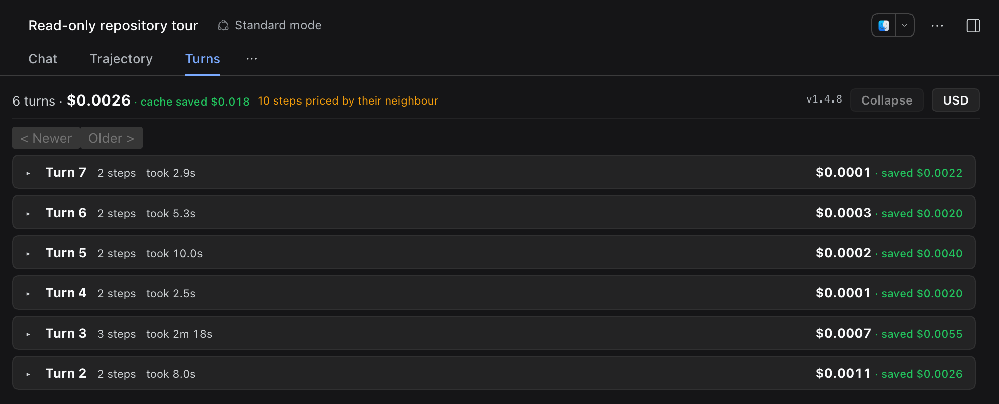
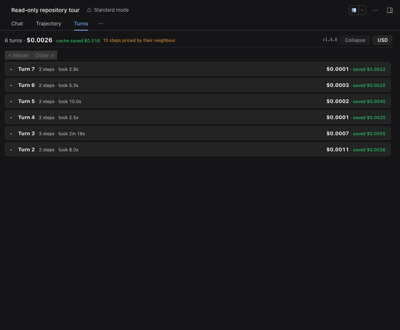

# dsh-turn-trace

> **A receipt for every turn.** A **Turns** tab inside DeepSeek Harness: expand a turn to see what it cost, expand a step to see what *that* cost.

[](https://github.com/topics/dsh-plugin)
[](https://www.npmjs.com/package/dsh-turn-trace)
[](LICENSE)

[中文](README.zh.md)



## What it does

- Turns are a list, collapsed. Each row is money and step count.
- Expand a turn: every step shows `Step i/n`, its tokens, and its money.
- Inside a step: the calls it made — `llm · model · 6.4s`, `bash · ok · 41s`.

Tools do not consume tokens. A step's tokens always belong to its model call, which is why the money sits on the step, not on the tool.

## Why not just use Trajectory?

Trajectory answers *when*: the event ledger and timing. Turns answers *how much*: each step's tokens and money, plus the calls that step made. It is additive — Chat and Trajectory stay exactly where they are.

Playback, wall-clock Gantts, and cross-session dashboards are deliberately out of scope; those already have better homes.

## Install

Requires the DeepSeek Harness desktop app (Homebrew cask `deepseek-harness`) or any `dsh` profile that serves the Web UI.

```sh
# from npm
dsh plugin --profile desktop add dsh-turn-trace

# from a local checkout
git clone https://github.com/nrenvo/dsh-turn-trace
cd dsh-turn-trace
pnpm install && pnpm build
dsh plugin --profile desktop add link:$PWD
```

Restart the app, open a session, and click **Turns** next to Chat and Trajectory.

## What you see



*A 7-second tour: expand a turn, click a call, and open the inspector.*

| Level | What it shows |
| --- | --- |
| Header | turn count, session total, cache savings, USD/CNY switch |
| Pager | ten turns per page, newest first; **Older** pulls the next history window |
| Turn | step count, wall-clock duration, money, money saved by cache |
| Step | `Step i/n`, money, tokens in/out, cache savings, priciest badge, cache-miss flag |
| Call | `llm`: model + duration · `tool`: status, error, duration, argument head · `user`: prompt |
| Inspector | click any row: overview, arguments, raw result, source |

The tab follows the DSH language setting (English / 中文); it does not guess from the browser.

## How it works

The view is **client-only**. It reads the chat snapshot the shell already holds
(`useChat` → `order` + `nodes`) and folds it into turns → steps → money. No host
plugin, no package-private RPC, no polling: the snapshot updates as the session
runs, so the view re-folds on every change.

### Pricing

Each call is priced from DeepSeek's published per-1M-token rates, using that call's own timestamp to pick peak or off-peak (peak: 01:00–04:00 and 06:00–10:00 UTC, weekdays). Rates live in [`src/pricing.ts`](src/pricing.ts) so they can be updated in one place. These are estimates, not billed amounts.

## Accuracy and limits

- **A step is priced from its own recorded model id** (`finalNode.requestConfig.model`, then `providerMetadata.model`). A step that carries no id inherits the nearest recorded model and is counted in the header; if the session recorded no model at all, the step stays unpriced instead of being guessed.
- Chinese public holidays are not modelled, so holiday sessions read slightly high.
- Only the loaded window is folded; **Older** pages older history in through the slot's `loadOlder`.

## Development

```sh
pnpm install
pnpm test            # fold + pricing assertions, no runtime needed
pnpm test:activation # boot-safety: apply() must never throw (needs a build)
pnpm typecheck       # tsc --noEmit
pnpm build           # tsdown, then wraps lib/client.js in __ModuleLoader__.load(...)
```

The client bundle registers through `window.__ModuleLoader__.load({ id, factory })`;
`scripts/wrap-client.mjs` adds that envelope after the CJS build, so the browser
half uses the runtime's `require('react')` instead of bundling its own copy.

`lib/` is committed so `github:` installs work. After changing source, run
`pnpm build` and commit `lib/` with the change.

## License

[MIT](LICENSE)
